# 📈 WORLD-X: Multi-Asset Price Predictor

An enterprise-grade, production-ready Streamlit application that delivers AI-powered price forecasts and automated financial news synthesis across multiple asset classes (Stocks, Cryptocurrencies, Forex, Precious Metals, and Crude Oil).

---

## 🏗️ Enterprise Architecture Design

The repository has been refactored into a standardized, decoupled layer-based architecture following modern software engineering best practices:

```mermaid
flowchart TD
    %% Base Infrastructure Styling
    classDef main fill:#d4edda,stroke:#28a745,stroke-width:2px;
    classDef config fill:#fff3cd,stroke:#ffc007,stroke-width:2px;
    classDef layer fill:#e2e3e5,stroke:#383d41,stroke-width:1px;
    classDef svc fill:#cce5ff,stroke:#004085,stroke-width:2px;
    classDef utl fill:#f8d7da,stroke:#721c24,stroke-width:2px;

    %% Components
    A[main.py: App Entry View Layer]:::main
    B[config/base_settings.py]:::config
    C[config/logger_config.py]:::config
    
    subgraph Services_Layer [🧠 Core Computational & Business Logic]
        D[services/forecasting_engine.py]:::svc
        E[services/llm_orchestrator.py]:::svc
    end

    subgraph Utilities_Layer [🔧 Functional I/O & Network Integrations]
        F[utils/yahoo_search.py]:::utl
        G[utils/exchange_detection.py]:::utl
        H[utils/market_trends.py]:::utl
        I[utils/news_scraper.py]:::utl
    end

    subgraph Output_Layer [📤 Report & Notification Orchestration]
        K[Report Generator Module]:::svc
        J[Notification Dispatch Module]:::svc
    end

    %% Dependency Connections
    A e1@--> B
    A e2@--> C
    A e3@--> Utilities_Layer
    A e4@--> Services_Layer
    
    D e5@--> B
    D e6@--> C
    E e7@--> C
    I e8@--> B
    I e9@--> C
    F e10@--> C
    G e11@--> C

    %% Report & Notification Orchestration
    K e12@--> C
    J e13@--> B
    J e14@--> C
    A e15@-.->|Generates Report| K
    A e16@-.->|Triggers Dispatch| J

    %% Running Flow Animation Definitions
    e1@{ animate: true }
    e2@{ animate: true }
    e3@{ animate: true }
    e4@{ animate: true }
    e5@{ animate: true }
    e6@{ animate: true }
    e7@{ animate: true }
    e8@{ animate: true }
    e9@{ animate: true }
    e10@{ animate: true }
    e11@{ animate: true }
    e12@{ animate: true }
    e13@{ animate: true }
    e14@{ animate: true }
    e15@{ animate: true }
    e16@{ animate: true }
```



---

## 🛠️ Features

* **Advanced Timeframe Forecasts:** Speeds through standard and extended horizons (`1 day`, `1 week`, `1 month`, `3 months`, `6 months`, `1 year`, `2 year`) using automated Prophet modeling mathematical trends.
* **Unified Multi-Market Currency mapping:** Instantly transforms backend tracking symbols into local global visual currency representations (e.g., **₹ for India**, **$ for the US**, **£ for the UK**, and **€ for Europe**).
* **Automated AI Summarization:** Connects seamlessly to specialized Google News RSS query subpaths and extracts bulleted financial context using the **Groq Llama 3.3** model.
* **Secure Environment Handlers:** Eliminates manual text-box inputs on the front end by securely parsing production system attributes out of local `.streamlit/secrets.toml` registries automatically.

---

## 🚀 Running App on Localhost (`:8509`)

To run this decoupled source code container or launch it locally using port assignment rules:

### 1. Provision Local Secrets
Create a local `.streamlit/secrets.toml` file to inject your tokens into memory securely:
```toml
GROQ_API_KEY = "gsk_your_private_groq_production_token_string_here"
```

### 2. Manual Command Execution
Install requirements and force Streamlit to listen directly on port **`8509`**:
```bash
pip install -r requirements.txt
python -m streamlit run src/main.py --server.port=8509 --server.address=127.0.0.1
```

### 3. Containerized Isolation Deployment (Docker)
Build and run the lightweight container, binding internal target workflows to host port **`8509`**:
```bash
# Build production engine image tag
docker build -t world-x-predictor .

# Fire up isolated workspace on port 8509
docker run -d -p 8509:8501 -e GROQ_API_KEY="gsk_your_key_here" --name predictor_instance world-x-predictor
```

Open your web browser and navigate directly to **`http://localhost:8509`** to test live local trading setups.

## License

This repository is licensed under the [MIT License](LICENSE) — Copyright (c) 2026 [T A Srinivas](https://github.com).

## Disclaimer

This project is intended for personal repository analytics, portfolio monitoring, and developer telemetry. Users are responsible for securing their Personal Access Tokens locally and adhering to GitHub API rate limits and terms of service.

## ⭐ Support & Contribution

If you clone, test, or build upon this repository, please consider giving it a **Star (⭐)** on GitHub—it helps others discover the project and supports continued development.

* **Found a bug or have an idea?** Open an [Issue](https://github.com).
* **Want to improve the code?** Feel free to **Fork** this repository and submit a Pull Request.
