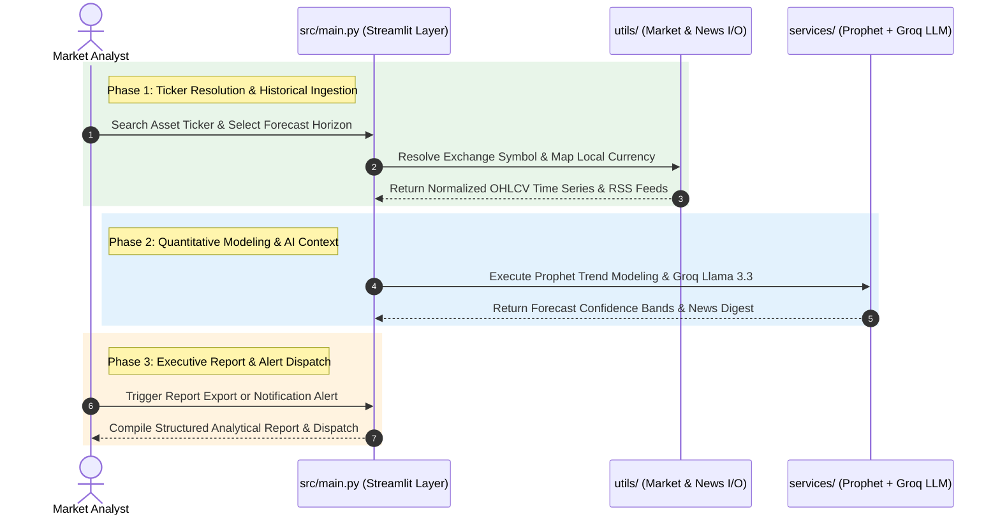

# 📈 WORLD-X — Multi-Asset Price Predictor

An enterprise-grade, production-ready quantitative workstation built with Streamlit that delivers AI-powered price forecasts, automated financial news synthesis, and executive reporting across multiple asset classes (Stocks, Cryptocurrencies, Forex, Precious Metals, and Crude Oil).


## 🏛️ System Architecture

The workstation decouples core mathematical forecasting, LLM news synthesis, and external market data ingestion from the Streamlit presentation layer to maintain a modular, predictable analytical workflow.

```mermaid
flowchart TD
    %% Base Infrastructure Styling
    classDef main fill:#d4edda,stroke:#28a745,stroke-width:2px;
    classDef config fill:#fff3cd,stroke:#ffc007,stroke-width:2px;
    classDef layer fill:#e2e3e5,stroke:#383d41,stroke-width:1px;
    classDef svc fill:#cce5ff,stroke:#004085,stroke-width:2px;
    classDef utl fill:#f8d7da,stroke:#721c24,stroke-width:2px;

    %% Components
    A[src/main.py: App Entry View Layer]:::main
    B[config/base_settings.py]:::config
    C[config/logger_config.py]:::config
    
    subgraph Services_Layer [🧠 Core Computational & Business Logic]
        D[services/forecasting_engine.py]:::svc
        E[services/llm_orchestrator.py]:::svc
    end

    subgraph Utilities_Layer [🔧 Functional I/O & Network Integrations]
        F[utils/yahoo_search.py]:::utl
        G[utils/exchange_detection.py]:::utl
        H[utils/market_trends.py]:::utl
        I[utils/news_scraper.py]:::utl
    end

    subgraph Output_Layer [📤 Report & Notification Orchestration]
        K[Report Generator Module]:::svc
        J[Notification Dispatch Module]:::svc
    end

    %% Dependency Connections
    A e1@--> B
    A e2@--> C
    A e3@--> Utilities_Layer
    A e4@--> Services_Layer
    
    D e5@--> B
    D e6@--> C
    E e7@--> C
    I e8@--> B
    I e9@--> C
    F e10@--> C
    G e11@--> C

    %% Report & Notification Orchestration
    K e12@--> C
    J e13@--> B
    J e14@--> C
    A e15@-.->|Generates Report| K
    A e16@-.->|Triggers Dispatch| J

    %% Running Flow Animation Definitions
    e1@{ animate: true }
    e2@{ animate: true }
    e3@{ animate: true }
    e4@{ animate: true }
    e5@{ animate: true }
    e6@{ animate: true }
    e7@{ animate: true }
    e8@{ animate: true }
    e9@{ animate: true }
    e10@{ animate: true }
    e11@{ animate: true }
    e12@{ animate: true }
    e13@{ animate: true }
    e14@{ animate: true }
    e15@{ animate: true }
    e16@{ animate: true }
```



### Forecasting & Intelligence Synthesis Pipeline



---

## 📁 Repository Directory Tree

```text
📁 world-x-predictor/
├── 📁 .streamlit/
│   ├── config.toml                   # Global dark/light theme layout & server configs
│   └── secrets.toml                  # Secure local registry for GROQ_API_KEY
├── 📁 config/
│   ├── base_settings.py              # Global asset constants, currencies, & horizon maps
│   └── logger_config.py              # Centralized structured runtime logging setup
├── 📁 services/
│   ├── forecasting_engine.py         # Automated Prophet time-series forecasting core
│   └── llm_orchestrator.py           # Groq Llama 3.3 financial news summarization engine
├── 📁 utils/
│   ├── yahoo_search.py               # Multi-asset ticker lookup & OHLCV data fetcher
│   ├── exchange_detection.py         # Exchange suffix & regional currency mapper (₹, \$, £, €)
│   ├── market_trends.py              # Technical trend indicators & volatility calculators
│   └── news_scraper.py               # Google News RSS query parser & headline extractor
├── 📁 src/
│   └── main.py                       # Modular Streamlit application entrypoint
├── Dockerfile                        # Containerized runtime definition (Port 8501 -> 8501)
├── requirements.txt                  # Pinned production Python dependencies
└── README.md                         # Architecture documentation & setup instructions
```
---

## 📊 Multi-Asset & Currency Profiles (`config/base_settings.py`)

The exchange detection engine (`utils/exchange_detection.py`) automatically maps ticker symbols to their native trading currencies and forecasting pipelines:

| Asset Class | Supported Exchanges & Tickers | Currency Mapping | Default System Behaviour & Invariants |
| :--- | :---: | :---: | :--- |
| **`EQUITIES`** *(Global Stocks)* | NSE/BSE (`.NS`, `.BO`), NYSE, NASDAQ, LSE | **₹, \$, £, €** | Automatically detects regional exchange suffixes and adjusts currency formatting dynamically. |
| **`CRYPTO`** *(Digital Assets)* | `BTC-USD`, `ETH-USD`, `SOL-USD` | **\$ (USD)** | Accounts for 24/7 continuous trading cycles without weekend market closure gaps. |
| **`FOREX`** *(Currency Pairs)* | `USDINR=X`, `EURUSD=X`, `GBPUSD=X` | **Native Quote** | Models macro exchange-rate momentum across major and emerging currency pairs. |
| **`COMMODITIES`** *(Metals & Energy)* | `GC=F` (Gold), `SI=F` (Silver), `CL=F` (Crude Oil) | **\$ (USD)** | Tracks global futures contracts alongside macro headline sentiment synthesis. |

---

## ⏱️ Supported Forecast Horizons (`services/forecasting_engine.py`)

Automated Prophet time-series projections support short-term tactical windows through multi-year strategic horizons:

```text
┌───────────────────┬─────────────────────────────┐
│ Horizon Selection │ Quantitative Modeling Scope │
├───────────────────┼─────────────────────────────┤
│ 1 Day / 1 Week    │ Short-term momentum & drift │
│ 1 Month / 3 Months│ Quarterly trend trajectory  │
│ 6 Months          │ Mid-term cyclical outlook   │
│ 1 Year / 2 Years  │ Long-term structural trend  │
└───────────────────┴─────────────────────────────┘
```

---

## 🛠️ Core Platform Capabilities

* **Advanced Timeframe Forecasts:** Computes standard and extended horizons (`1 day`, `1 week`, `1 month`, `3 months`, `6 months`, `1 year`, `2 years`) using automated Prophet time-series modeling.
* **Unified Multi-Market Currency Mapping:** Instantly transforms backend tracking symbols into local visual currency representations (**₹** for India, **$** for the US, **£** for the UK, and **€** for Europe).
* **Automated AI Summarization:** Connects seamlessly to specialized Google News RSS query subpaths and extracts concise financial context using the **Groq Llama 3.3** model.
* **Secure Environment Handlers:** Eliminates manual API key inputs on the front end by securely parsing production tokens directly from `.streamlit/secrets.toml` or environment variables.

---

## 🚀 Local Host Installation & Boot Instructions (`:8501`)

To run the workstation engine locally or via Docker container on port **`8501`**, follow these steps:

### 1. Local Python Virtual Environment Execution
```bash
# 1. Access project workspace path
cd world-x-predictor

# 2. Spawn targeted Python virtual node
python3 -m venv venv

# 3. Initialize terminal activation link context
# On macOS/Linux:
source venv/bin/activate
# On Windows PowerShell:
.\venv\Scripts\Activate.ps1

# 4. Ingest packages and boot Streamlit on port 8501
pip install -r requirements.txt
python -m streamlit run src/main.py --server.port=8501 --server.address=127.0.0.1
```

### 2. Containerized Isolation Deployment (Docker)
Build and run the lightweight container, mapping internal port `8501` to host port **`8501`**:
```bash
# Build production engine image tag
docker build -t world-x-predictor .

```
Access the application directly in your browser at:
👉 **`http://localhost:8501`**

---

## ⚠️ Quantitative & Market Disclaimer

> **Important Notice:** This platform is engineered exclusively for educational purposes, personal market research, and quantitative analysis, and does not constitute financial or investment advice. Users remain responsible for securing local API credentials (`GROQ_API_KEY`) and complying with the rate limits and terms of service of Yahoo Finance, Google News, and Groq.

---
## 🛡️ License, Copyright & Compliance Notices

**All Rights Reserved © 2026 T A Srinivas.**

> **Strict Intellectual Property Notice:** This repository is strictly for portfolio viewing and technical evaluation purposes. **DO NOT COPY, CLONE, FORK, OR REDISTRIBUTE** this source code, architecture, or documentation. Stolen copies or unauthorized forks will be reported immediately for a **GitHub DMCA copyright takedown**.

For corporate licensing, enterprise deployment, or commercial inquiries, please contact **`tasrinivass@gmail.com`**.

* **Lead Architect & Developer:** [Srinivasta](https://github.com/SRINIVASTA)

### 🌐 Let’s Connect

- [](https://www.linkedin.com/in/srinivas-t-a-557637119/)  
- [](https://www.kaggle.com/srinivasta)  
- [](mailto:tasrinivass@gmail.com)  
- [](https://github.com/srinivasta)
- [](https://srinivasta.github.io)

